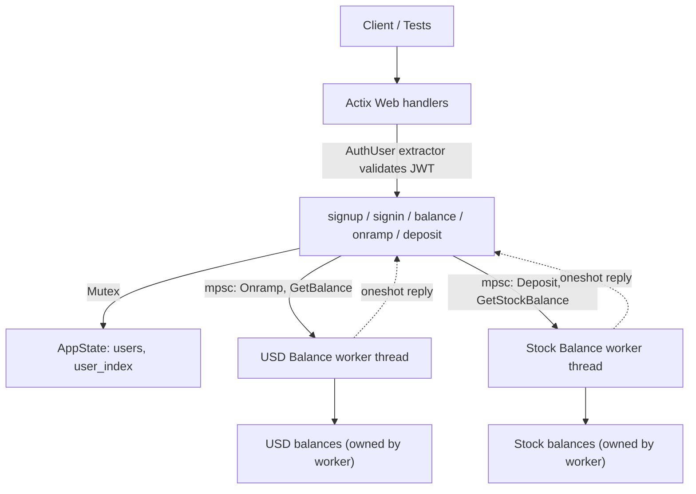

# cex-rust — a centralized exchange backend, built to learn

A centralized cryptocurrency exchange (CEX) backend in **Rust** and **Actix Web**. The exchange holds user funds, authenticates users, and (eventually) matches their buy and sell orders itself, unlike a DEX, where swaps settle on-chain.

This is a learning project. I'm building it in small, tested steps to understand how exchange backends handle identity, balances, concurrency, and eventually order matching. **It is not safe for real funds.** See [Known issues](#known-issues).

> A parallel TypeScript implementation lives in [`../cex-ts`](../cex-ts) so I can compare how the two runtimes handle the same problem.

---

## Status at a glance

| Endpoint | Auth | Status | Notes |
| --- | --- | --- | --- |
| `POST /signup` | none | Working | Password hashed with bcrypt; duplicate usernames rejected |
| `POST /signin` | none | Working | Verified with bcrypt; returns a 24h JWT |
| `GET /balance` | JWT | Working | USD and stock balances from dedicated worker threads via mpsc + oneshot |
| `POST /onramp` | JWT | Working | Fire-and-forget message to the balance worker |
| `POST /deposit/{asset_symbol}` | JWT | Working | Fire-and-forget message to the stock balance worker |
| `POST /order`, `POST /cancel` | JWT | Not started | Stubbed as comments; needs an order book |

---

## Tech stack

| Tool | Why |
| --- | --- |
| Rust (edition 2024) | Ownership and type system make shared-state bugs visible at compile time |
| Actix Web 4 | HTTP server; requests are handled concurrently on a thread pool |
| bcrypt | Password hashing with adaptive work factor and salting |
| Serde / serde_json | Request and response (de)serialization; `camelCase` for API output |
| jsonwebtoken + chrono | Signing JWTs and computing expiry |
| `std::sync::Mutex` | Guarding shared user state (`users`, `user_index`) |
| `std::sync::mpsc` + `futures::channel::oneshot` | Message passing to the USD and stock balance workers and getting replies back |
| Cargo test + Bun / Axios | Unit tests via `cargo test` and integration tests against the running server |

---

## Architecture



Code layout:

```
src/
  main.rs              AppState, BalanceMessage & StockBalanceMessage enums, worker threads, server setup
  middleware.rs        AuthUser extractor (JWT validation), AuthError
  routes/user.rs       signup, signin, balance, onramp, deposit handlers, tests
  types/user.rs        User, request/response structs, JWT Claims
```

---

## Engineering logic so far

### 1. Actor-style (message passing) for balances

Both USD and stock balances are owned by dedicated worker threads. Handlers cannot mutate the balance maps directly:

- **USD Balances**: Handlers send `BalanceMessage` (`Onramp` or `GetBalance`).
- **Stock Balances**: Handlers send `StockBalanceMessage` (`Deposit` or `GetStockBalance`).

```rust
pub enum BalanceMessage {
    Onramp(u32, u32),                                  // user_id, amount
    GetBalance(u32, oneshot::Sender<u32>),             // user_id, reply channel
}

pub enum StockBalanceMessage {
    Deposit(u32, String, u32),                         // user_id, symbol, amount
    GetStockBalance(u32, oneshot::Sender<HashMap<String, u32>>), // user_id, reply channel
}
```

The workers process messages sequentially, eliminating data races on balance maps without requiring locks around balance logic.

- **Lock-based (`Mutex`)**: Reserved only for `users` and `user_index` in `AppState`.

### 2. Request/response over a one-way channel

`mpsc` only flows one direction. To read a balance, the handler creates a `oneshot` channel, sends its `Sender` inside the message, and `await`s the `Receiver`:

```rust
let (tx, rx) = oneshot::channel::<u32>();
app_state.balances_tx.send(BalanceMessage::GetBalance(user_id, tx));
let usd_balance = rx.await.unwrap();
```

Because the worker is single-threaded and the channel is FIFO, an `Onramp` sent before a `GetBalance` is always applied before it. So a client that calls `/onramp` and then `/balance` sees its own write, even though `/onramp` returns without waiting for the worker.

### 3. Password security with bcrypt

Passwords are never stored in plaintext:

- On `/signup`, `bcrypt::hash(&body.password, DEFAULT_COST)` hashes the password before saving the user in state.
- On `/signin`, `bcrypt::verify(&body.password, &user.password)` compares the password safely.
- Unknown usernames and invalid passwords both yield `401 Unauthorized ("Incorrect credentials")` to prevent user enumeration attacks.

### 4. Authentication as an extractor

`AuthUser` implements Actix's `FromRequest`. Any handler that declares `user: AuthUser` as a parameter is automatically protected: the extractor reads `Authorization: Bearer <token>`, decodes the JWT, and yields the user ID from the `sub` claim. If validation fails, the handler never runs.

Two consequences I like:
- The user identity **always comes from the token**, never from the URL or body, so a client can't act as another user by changing a parameter.
- Auth is declared in the handler signature, so it can't be forgotten by omission in a router config.

### 5. Money as integers

Balances and quantities are integers (`u32`), never floats, to avoid rounding errors. The plan is to move to a wider type and define explicit units (for example, cents for USD, smallest units for assets).

---

## Known issues

Found while reviewing the code, roughly in priority order.

**Correctness**

1. **Overflow can kill the worker.** `amount + existing_amount` on `u32` panics in debug builds and wraps silently in release. If the worker thread panics, every later `GetBalance` fails and `rx.await.unwrap()` panics in the handler. Fix: `checked_add`, a wider type, and returning an error instead of unwrapping.
2. **Onramp & deposit are fire-and-forget.** Handlers return `200` without confirmation, and send errors are ignored (`let _ =`). If the worker thread crashes, clients are told the operation succeeded.
3. **Two balance actors vs. matching engine atomicity.** USD and stock balances live in separate worker threads. While lock-free and decoupled for isolated deposits, trade execution requires debiting one asset and crediting another atomically, which motivates unifying both under a single matching engine actor.

**Security** (must be fixed before anything real)

4. The JWT secret is hardcoded in two places (`"secret"`), and the `JWT_SECRET` constant in `middleware.rs` is unused. Load one secret from the environment.
5. The `Bearer ` prefix is optional (`trim_start_matches`), so a bare token is accepted.

**API quality**

6. Status codes: duplicate signup returns `401` (should be `409`); a missing or invalid token returns `400` (should be `401`).
7. `println!("Hi from middleware 1")` is leftover debug output.
8. `users` is a `Vec` searched linearly. A `HashMap` keyed by username would be O(1).
9. Asset symbols are case-sensitive (`BTC` and `btc` are different assets). Normalize them.
10. Cargo.toml lists a crate named `web`, which looks like an accidental auto-import. Remove it unless intentional.

---

## Design direction: one engine thread

The balance workers are the seed of the matching engine. The matching engine needs to change USD balances, asset balances, and the order book together, and a single owning thread gives that atomicity without locks. The plan:

```rust
enum EngineMessage {
    Onramp { user_id, amount },
    Deposit { user_id, asset, qty },
    GetBalances { user_id, reply },
    PlaceOrder { user_id, order, reply },
    CancelOrder { user_id, order_id, reply },
}
```

The engine owns balances and the order book, applies each message to completion, and replies over a `oneshot`. Handlers stay thin: validate, send, await. This also gives a deterministic ordering of events that is easy to test and later to persist or replay.

---

## Roadmap

**Phase 1: core backend**
- [x] Actix server, signup/signin, JWT
- [x] Protected `/balance`, message-driven USD worker, `/onramp`
- [x] Message-driven stock balance worker, `/deposit/{asset_symbol}` wired up
- [x] Password hashing with `bcrypt` (signup hash, signin verification)
- [x] Unit tests with `cargo test`
- [x] Integration tests with Bun + Axios
- [ ] Consistent error types and status codes

**Phase 2: trading engine**
- [ ] Order types and `POST /order`, `POST /cancel`
- [ ] In-memory order book with price-time priority (FIFO within a price level)
- [ ] Matching, partial fills, balance updates after trades

**Phase 3: financial correctness**
- [ ] Reject overspending and negative balances
- [ ] Lock funds when an order is placed and release them on cancel or fill
- [ ] Merge USD and asset balances under the single engine
- [ ] Trade and transaction history; idempotent operations

**Phase 4: production concerns**
- [x] Password hashing (bcrypt)
- [ ] Env-based secrets, request validation
- [ ] PostgreSQL for users, orders, and trades
- [ ] Logging, load and failure-recovery tests, Docker, CI

---

## What I've learned so far

| Concept | Where it shows up |
| --- | --- |
| Ownership and borrowing | Moving balance maps into dedicated worker threads so only they can mutate them |
| Enums and pattern matching | `BalanceMessage` / `StockBalanceMessage` and worker `match` loops |
| Password security | Salting and hashing passwords via `bcrypt` to prevent plain text exposure |
| `Mutex` and lock scope | Guards on `users` and `user_index`; keep critical sections short |
| `mpsc` vs `oneshot` | Handlers send commands over `mpsc`, worker replies via per-request `oneshot` |
| Extractors | `AuthUser` as declarative, per-handler authentication |
| Integration testing | Testing through Actix test services and real HTTP |

---

## Running locally

Requires Rust/Cargo, plus [Bun](https://bun.sh) for the integration tests.

```bash
cd cex-rust
cargo test                                  # runs internal unit tests (auth, etc.)
cargo run                                   # serves on http://127.0.0.1:3001
```

In a second terminal:

```bash
export RUST_BACKEND_URL=http://127.0.0.1:3001     # PowerShell: $env:RUST_BACKEND_URL="http://127.0.0.1:3001"
bun test
```

Quick manual check:

```bash
curl -X POST localhost:3001/signup -H 'Content-Type: application/json' -d '{"username":"amit","password":"123123"}'
TOKEN=$(curl -s -X POST localhost:3001/signin -H 'Content-Type: application/json' -d '{"username":"amit","password":"123123"}' | jq -r .token)
curl -X POST localhost:3001/onramp -H "Authorization: Bearer $TOKEN" -H 'Content-Type: application/json' -d '{"qty":100}'
curl -X POST localhost:3001/deposit/BTC -H "Authorization: Bearer $TOKEN" -H 'Content-Type: application/json' -d '{"qty":5}'
curl localhost:3001/balance -H "Authorization: Bearer $TOKEN"
```

Everything is in memory, so all users and balances reset when the server restarts.
