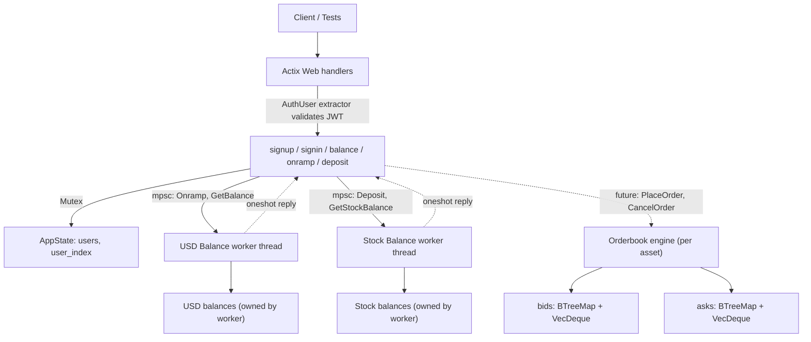
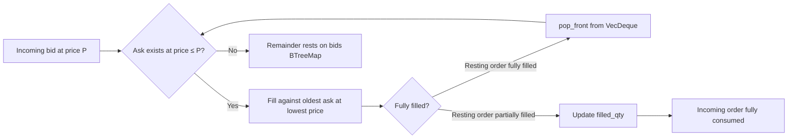

# cex-rust — a centralized exchange backend, built to learn

A centralized cryptocurrency exchange (CEX) backend in **Rust** and **Actix Web**. The exchange holds user funds, authenticates users, and matches their buy and sell orders itself, unlike a DEX, where swaps settle on-chain.

This is a learning project. I'm building it in small, tested steps to understand how exchange backends handle identity, balances, concurrency, and order matching. **It is not safe for real funds.** See [Known issues](#known-issues).

> A parallel TypeScript implementation lives in [`../cex-ts`](../cex-ts) so I can compare how the two runtimes handle the same problem.


## Tech stack

| Tool | Why |
| --- | --- |
| Rust (edition 2024) | Ownership and type system make shared-state bugs visible at compile time |
| Actix Web 4 | HTTP server; requests are handled concurrently on a thread pool |
| bcrypt | Password hashing with adaptive work factor and salting |
| Serde / serde_json | Request and response (de)serialization; `camelCase` for API output |
| jsonwebtoken + chrono | Signing JWTs and computing expiry |
| `std::sync::Mutex` | Guarding shared user state (`users`, `user_index`) |
| `std::sync::mpsc` + `futures::channel::oneshot` | Message passing to the USD and stock balance workers and getting replies back |
| `BTreeMap<u32, VecDeque<RestingOrder>>` | Orderbook storage — sorted price keys + FIFO queues for price-time priority (see [§6](#6-orderbook-matching-engine--data-structure-choices)) |
| Cargo test + Bun / Axios | Unit tests via `cargo test` and integration tests against the running server |

---

## Architecture



Code layout:

```
src/
  lib.rs               Shared crate root: module declarations, BalanceMessage, StockBalanceMessage, AppState
  main.rs              Binary entry point: worker thread spawning, Actix server setup
  middleware/mod.rs     AuthUser extractor (JWT validation), AuthError
  routes/user.rs       signup, signin, balance, onramp, deposit handlers
  types/user.rs        User, request/response structs (incl. OrderRequest, OrderResponse, CancelRequest, CancelResponse), JWT Claims
  orderbook.rs         Orderbook matching engine: add_order, cancel_order, get_depth, get_snapshot
tests/
  auth_test.rs         bcrypt signup/signin integration test
  orderbook_test.rs    13 orderbook matching engine tests
```

---

## Engineering logic so far

### 1. Actor-style (message passing) for balances

Both USD and stock balances are owned by dedicated worker threads. Handlers cannot mutate the balance maps directly:

- **USD Balances**: Handlers send `BalanceMessage` (`Onramp` or `GetBalance`).
- **Stock Balances**: Handlers send `StockBalanceMessage` (`Deposit` or `GetStockBalance`).

```rust
pub enum BalanceMessage {
    Onramp(u32, u32),                                  // user_id, amount
    GetBalance(u32, oneshot::Sender<u32>),             // user_id, reply channel
}

pub enum StockBalanceMessage {
    Deposit(u32, String, u32),                         // user_id, symbol, amount
    GetStockBalance(u32, oneshot::Sender<HashMap<String, u32>>), // user_id, reply channel
}
```

The workers process messages sequentially, eliminating data races on balance maps without requiring locks around balance logic.

- **Lock-based (`Mutex`)**: Reserved only for `users` and `user_index` in `AppState`.

### 2. Request/response over a one-way channel

`mpsc` only flows one direction. To read a balance, the handler creates a `oneshot` channel, sends its `Sender` inside the message, and `await`s the `Receiver`:

```rust
let (tx, rx) = oneshot::channel::<u32>();
app_state.balances_tx.send(BalanceMessage::GetBalance(user_id, tx));
let usd_balance = rx.await.unwrap();
```

Because the worker is single-threaded and the channel is FIFO, an `Onramp` sent before a `GetBalance` is always applied before it. So a client that calls `/onramp` and then `/balance` sees its own write, even though `/onramp` returns without waiting for the worker.

### 3. Password security with bcrypt

Passwords are never stored in plaintext:

- On `/signup`, `bcrypt::hash(&body.password, DEFAULT_COST)` hashes the password before saving the user in state.
- On `/signin`, `bcrypt::verify(&body.password, &user.password)` compares the password safely.
- Unknown usernames and invalid passwords both yield `401 Unauthorized ("Incorrect credentials")` to prevent user enumeration attacks.

### 4. Authentication as an extractor

`AuthUser` implements Actix's `FromRequest`. Any handler that declares `user: AuthUser` as a parameter is automatically protected: the extractor reads `Authorization: Bearer <token>`, decodes the JWT, and yields the user ID from the `sub` claim. If validation fails, the handler never runs.

Two consequences I like:
- The user identity **always comes from the token**, never from the URL or body, so a client can't act as another user by changing a parameter.
- Auth is declared in the handler signature, so it can't be forgotten by omission in a router config.

### 5. Money as integers

Balances and quantities are integers (`u32`), never floats, to avoid rounding errors. The plan is to move to a wider type and define explicit units (for example, cents for USD, smallest units for assets).

### 6. Orderbook matching engine — data structure choices

The orderbook is the core of the exchange: it matches buy orders (bids) against sell orders (asks) using **price-time priority** — best price first, earliest order first within the same price.

#### Why `BTreeMap<u32, VecDeque<RestingOrder>>` and not `HashMap`

```rust
pub struct Orderbook {
    bids: BTreeMap<u32, VecDeque<RestingOrder>>,
    asks: BTreeMap<u32, VecDeque<RestingOrder>>,
}
```

**`BTreeMap` keeps price levels sorted automatically.** The keys are prices, and `BTreeMap` maintains them in ascending order. This means:

- **Asks** (sellers): `.iter()` yields lowest price first — exactly what a buyer wants to match against.
- **Bids** (buyers): `.iter().rev()` yields highest price first — exactly what a seller wants to match against.

With a `HashMap`, you'd need to collect all keys and sort them on every incoming order, which is what the TypeScript version does:

```typescript
// TypeScript: must sort keys every time
const askPrices = [...this.asks.keys()].sort((a, b) => parseFloat(a) - parseFloat(b));
```

`BTreeMap` gives O(log n) insert and lookup vs `HashMap`'s O(1), but for an orderbook that's a worthwhile trade — you get **free sorted iteration** and never pay for a sort pass on the hot path.

#### Why `VecDeque` and not `Vec`

Each price level holds a FIFO queue of orders. When an incoming order matches, it fills the **oldest resting order first** (time priority). This means we're always removing from the front:

- `VecDeque::pop_front()` — **O(1)**, just moves the head pointer in the ring buffer.
- `Vec::remove(0)` — **O(n)**, shifts every remaining element left.

For an actively traded price level with many resting orders, this difference matters. New orders go to the back with `push_back()`, which is O(1) for both, so `VecDeque` wins on the operation that matters.

#### Matching flow



#### Tagged enum for match events

```rust
#[derive(Serialize, Deserialize)]
#[serde(tag = "type")]
pub enum MatchEvent {
    Fill { buyer, seller, price, qty },
    OrderbookUpdate { user_id, price, qty, order_id },
}
```

`#[serde(tag = "type")]` produces clean JSON with a `"type": "fill"` or `"type": "orderbook_update"` discriminator, ready for WebSocket broadcasting later. Rust's tagged enum guarantees exhaustive `match` — the compiler forces handling of both variants.

#### How cancel works

`cancel_order(order_id)` does a linear scan of all price buckets on both sides. This is O(total orders) — acceptable for now, but a `HashMap<order_id, (side, price)>` index would make it O(log n). Added to the roadmap.

**API quality**

7. Status codes: duplicate signup returns `401` (should be `409`); a missing or invalid token returns `400` (should be `401`).
8. `println!("Hi from middleware 1")` is leftover debug output.
9. `users` is a `Vec` searched linearly. A `HashMap` keyed by username would be O(1).
10. Asset symbols are case-sensitive (`BTC` and `btc` are different assets). Normalize them.
11. Cargo.toml lists a crate named `web`, which looks like an accidental auto-import. Remove it unless intentional.

---

## Design direction: one engine thread

The balance workers are the seed of the matching engine. The matching engine needs to change USD balances, asset balances, and the order book together, and a single owning thread gives that atomicity without locks. The plan:

```rust
enum EngineMessage {
    Onramp { user_id, amount },
    Deposit { user_id, asset, qty },
    GetBalances { user_id, reply },
    PlaceOrder { user_id, order, reply },
    CancelOrder { user_id, order_id, reply },
}
```

The engine owns balances and the order book, applies each message to completion, and replies over a `oneshot`. Handlers stay thin: validate, send, await. This also gives a deterministic ordering of events that is easy to test and later to persist or replay.


## What I've learned so far

| Concept | Where it shows up |
| --- | --- |
| Ownership and borrowing | Moving balance maps into dedicated worker threads so only they can mutate them |
| Enums and pattern matching | `BalanceMessage` / `StockBalanceMessage` and worker `match` loops |
| Password security | Salting and hashing passwords via `bcrypt` to prevent plain text exposure |
| `Mutex` and lock scope | Guards on `users` and `user_index`; keep critical sections short |
| `mpsc` vs `oneshot` | Handlers send commands over `mpsc`, worker replies via per-request `oneshot` |
| Extractors | `AuthUser` as declarative, per-handler authentication |
| `BTreeMap` vs `HashMap` | Sorted keys give free price-priority iteration without collect-and-sort on every order |
| `VecDeque` for FIFO queues | O(1) `pop_front` for time-priority matching; `Vec` would be O(n) for front removal |
| Tagged enums with serde | `#[serde(tag = "type")]` on `MatchEvent` for clean JSON discriminators |
| Modular test layout | Integration tests in `tests/` directory, keeping source files focused on production code |

---

## Running locally

Requires Rust/Cargo, plus [Bun](https://bun.sh) for the integration tests.

```bash
cd cex-rust
cargo test                                  # 14 tests: auth + orderbook matching engine
cargo run                                   # serves on http://127.0.0.1:3001
```

In a second terminal:

```bash
export RUST_BACKEND_URL=http://127.0.0.1:3001     # PowerShell: $env:RUST_BACKEND_URL="http://127.0.0.1:3001"
bun test
```

Quick manual check:

```bash
curl -X POST localhost:3001/signup -H 'Content-Type: application/json' -d '{"username":"amit","password":"123123"}'
TOKEN=$(curl -s -X POST localhost:3001/signin -H 'Content-Type: application/json' -d '{"username":"amit","password":"123123"}' | jq -r .token)
curl -X POST localhost:3001/onramp -H "Authorization: Bearer $TOKEN" -H 'Content-Type: application/json' -d '{"qty":100}'
curl -X POST localhost:3001/deposit/BTC -H "Authorization: Bearer $TOKEN" -H 'Content-Type: application/json' -d '{"qty":5}'
curl localhost:3001/balance -H "Authorization: Bearer $TOKEN"
```

Everything is in memory, so all users and balances reset when the server restarts.
